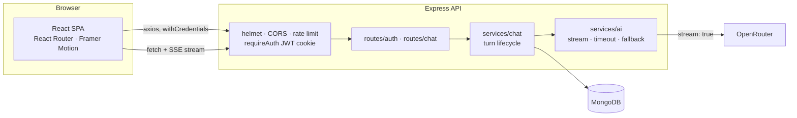
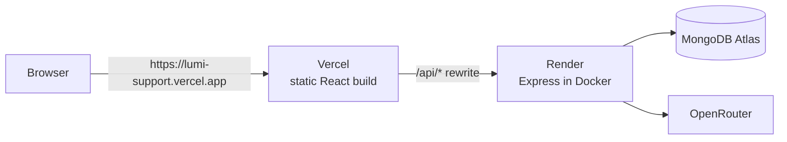

# Lumi — AI Customer Support Agent

A full-stack AI customer-support chat app. Users sign up, chat with an AI assistant whose replies **stream in token by token**, and keep a private, searchable history of their conversations.

**Stack:** React 18 + Vite · Node.js 20 + Express · MongoDB (Mongoose) · JWT in httpOnly cookies + bcrypt · OpenRouter · Docker

> **Live demo:** _add your deployed URL here_

---

## Features

### Required

| Requirement | Implementation |
|---|---|
| Signup / login / logout with JWT | 7-day JWT in an **httpOnly cookie** (no token in `localStorage`, so XSS can't steal it) |
| bcrypt password hashing | `bcryptjs`, 12 salt rounds; hash is `select: false` and stripped from all JSON |
| Protected routes | Server: `requireAuth` middleware. Client: React Router `ProtectedRoute` / `PublicOnlyRoute` with redirect-back |
| Chat UI, AI responses | Streaming replies (SSE) with Markdown rendering |
| History in MongoDB, user-scoped | Every query filters by the authenticated user's id; foreign ids return 404 |
| Past conversations | Sidebar grouped by Today / Yesterday / Previous 7 days…, with search |
| `/auth/signup`, `/auth/login`, `/chat/send`, `/chat/history` | ✅ plus `/auth/logout`, `/auth/me`, streaming, rename, delete, clear |
| Docker, `docker compose up` | Multi-stage images, MongoDB included, healthchecks, works from a clean clone |

### Bonus (all done)
- **Typing indicator**, then a live streaming caret
- **Rate limiting:** 100 req / 15 min per IP globally; 10 / 15 min on login and signup; 20 messages / min per user
- **Dev/prod config switching:** cookie policy, CORS, logging format, error verbosity, proxy trust

### Extras
- ⚡ **Real-time streaming** over Server-Sent Events, with a **Stop generating** button (Esc)
- 🎙️ **Speech-to-text** voice input (`react-speech-recognition` / Web Speech API)
- 🗑️ **Delete a conversation** or **clear all history**, both behind an accessible confirm dialog
- ✏️ **Rename** conversations inline
- 🔁 **Retry** failed messages; the server rolls back failed turns so history never has orphaned messages
- 🌓 **Light/dark theme** (follows the OS, remembered, no flash on load)
- 📱 Responsive down to mobile with a slide-out drawer
- ✨ Animations (Framer Motion): message entrance, staggered welcome screen, list transitions, modal springs
- 📋 Copy-to-clipboard on answers, ⌘/Ctrl+K for a new chat, Enter to send / Shift+Enter for a newline
- ♿ Labelled controls, `aria-live` streaming, focus management, `prefers-reduced-motion` support

---

## Architecture



**A chat turn** (`POST /chat/send/stream`):
1. Validate (zod), then load the conversation **scoped to the user** (or create one, titled from the first ~40 characters).
2. Save the user message and load the last 10 messages as context.
3. Stream from OpenRouter. Each token is forwarded as an SSE `token` event.
4. On success, save the reply and emit `done`. On failure, roll back the turn and emit a friendly `error`. If the client disconnects (Stop), abort the upstream request and keep the partial answer.

```
server/src
├── config/        env.js (dev/prod switching) · db.js · logger.js
├── middleware/    auth.js · rateLimit.js · errorHandler.js (HttpError, asyncHandler)
├── models/        User · Conversation · Message (with compound indexes)
├── routes/        auth.js · chat.js        ← thin HTTP layer
├── services/      chat.js (turn lifecycle) · ai.js (OpenRouter streaming client)
├── app.js         Express app (exported for tests)
└── index.js       DB connect, listen, graceful shutdown

client/src
├── api/           axios client + interceptors · auth · chat (SSE reader)
├── context/       AuthContext (session restore, expiry) · ThemeContext
├── hooks/         useChat (stream/stop/retry state machine) · useConversations
├── components/    chat/* · auth/* · ui/* · routing/ProtectedRoute
└── pages/         LoginPage · SignupPage · ChatPage (lazy-loaded)
```

---

## Quick start

### Prerequisites
- Node.js **20.10+**
- An **OpenRouter API key** (free): https://openrouter.ai/keys
- One of: **Docker**, **MongoDB Atlas** (free M0), or nothing (see `npm run db:dev`)

### Option A: Docker (one command)

```bash
cp server/.env.example server/.env   # then set OPENROUTER_API_KEY (and JWT_SECRET)
docker compose up --build
```
App: http://localhost:5173 · API: http://localhost:5000/health

Compose runs MongoDB for you. To use Atlas instead, put `MONGODB_URI=...` in a root `.env` file.

### Option B: Run locally

```bash
# 1. API
cd server
cp .env.example .env        # set OPENROUTER_API_KEY; MONGODB_URI if using Atlas
npm install
npm run db:dev              # (optional) zero-install local MongoDB on :27017, in its own terminal
npm run dev                 # http://localhost:5000

# 2. Client (new terminal)
cd client
cp .env.example .env
npm install
npm run dev                 # http://localhost:5173
```

> `npm run db:dev` starts a real `mongod`, downloaded automatically by `mongodb-memory-server`, with data persisted in `server/.mongo-data/`. No MongoDB install, Docker, or admin rights needed.

### Getting the external credentials
- **OpenRouter:** sign in at https://openrouter.ai, go to **Keys**, and create a key. Free models end in `:free`; `openrouter/free` auto-routes to an available free model.
- **MongoDB Atlas:** create a free **M0** cluster. Under **Database Access**, add a user. Under **Network Access**, allow your IP (or `0.0.0.0/0` for Render/Railway). Then go to **Connect → Drivers**, copy the `mongodb+srv://…` URI, and add a database name (e.g. `/ai-support-agent`).

---

## Environment variables

### `server/.env`

| Variable | Required | Default | Notes |
|---|---|---|---|
| `NODE_ENV` | | `development` | `production` enables secure `SameSite=None` cookies, JSON logs, trust proxy, generic 500s |
| `PORT` | | `5000` | |
| `MONGODB_URI` | ✅ prod | `mongodb://127.0.0.1:27017/ai-support-agent` | Atlas URI in production |
| `JWT_SECRET` | ✅ prod | dev-only fallback | 32+ random chars; the server refuses to start in production without it |
| `CLIENT_URL` | ✅ | `http://localhost:5173` | CORS allow-list; comma-separate multiple origins |
| `OPENROUTER_API_KEY` | ✅ | | |
| `OPENROUTER_MODEL` | | `openrouter/free` | e.g. `meta-llama/llama-3.3-70b-instruct:free` |
| `OPENROUTER_FALLBACK_MODEL` | | | Tried automatically if the primary fails before streaming starts |
| `TRUST_PROXY` | | `1` in prod, `0` otherwise | Hops of reverse proxy; needed for correct client IPs in rate limiting (`2` behind the Vercel rewrite) |
| `COOKIE_SAMESITE` | | `none` in prod, `lax` otherwise | Use `lax` when the API is proxied under the client's domain |

### `client/.env`

| Variable | Default | Notes |
|---|---|---|
| `VITE_API_URL` | `http://localhost:5000` in dev, `/api` in production builds | API base URL, inlined at build time. Leave unset on Vercel to use the `/api` rewrite. |

---

## API reference

Every error response has the shape `{ "error": "message" }`. Chat routes require the auth cookie.

| Method | Path | Body | Response |
|---|---|---|---|
| `GET` | `/health` | | `{ ok, db }` |
| `POST` | `/auth/signup` | `{ email, password, name? }` | `201 { user }` + cookie · `409` duplicate |
| `POST` | `/auth/login` | `{ email, password }` | `200 { user }` + cookie · `401` |
| `POST` | `/auth/logout` | | `200`, clears cookie |
| `GET` | `/auth/me` | | `{ user }` · `401` |
| `POST` | `/chat/send` | `{ message, conversationId? }` | `{ conversationId, conversation, userMessage, message }` |
| `POST` | `/chat/send/stream` | `{ message, conversationId? }` | SSE: `meta` → `token`… → `done` \| `error` |
| `GET` | `/chat/history` | | `{ conversations }`, most recent first |
| `GET` | `/chat/history/:id` | | `{ conversation, messages }` |
| `PATCH` | `/chat/history/:id` | `{ title }` | `{ conversation }` |
| `DELETE` | `/chat/history/:id` | | `204` |
| `DELETE` | `/chat/history` | | `{ deletedCount }` (clear all) |

AI failures map to friendly messages and never expose provider details: `429` (busy), `504` (timeout), `502` (unavailable), `503` (not configured).

---

## Testing

```bash
cd server && npm test        # 47 API tests (in-memory MongoDB, mocked OpenRouter)
cd client && npm run test:e2e # browser E2E in headless Chrome/Edge; screenshots in tests/screenshots/
```

The tests cover:
- **Auth:** signup and login, validation, duplicate email, wrong password, case-insensitive email, bcrypt cost, cookie flags, protected routes, logout.
- **Chat:** send, continue with context, 10-message context window, model fallback, 429/504 mapping, no leaked provider errors, rollback on failure, SSE event sequence.
- **Isolation:** user B cannot read, post into, rename or delete user A's conversation, and "clear all" only touches your own data.
- **Rate limits:** login lockout after 10 attempts, while `/auth/me` and `/health` are never blocked.
- **Security:** Helmet headers, 100 kB body limit, malformed JSON, JSON 404s, no `X-Powered-By`.
- **E2E:** redirect to login → bad login → signup validation → send message (typing indicator, streaming, Markdown, URL update) → reload persists → theme persists → mobile drawer → delete with confirm → logout.

---

## Deployment



| Part | Host | Config in repo |
|---|---|---|
| React client | **Vercel** (free) | `client/vercel.json` |
| Express API | **Render** web service, Docker (free) | `render.yaml` (Blueprint) + `server/Dockerfile` |
| Database | **MongoDB Atlas** M0 (free) | `MONGODB_URI` |

**Why a rewrite instead of calling the API directly?** The site (`*.vercel.app`) and the API (`*.onrender.com`) are different sites, which would make the auth cookie a **third-party cookie**. Safari, Brave and incognito Chrome block those by default. Vercel forwards `/api/*` to Render, so the browser only ever talks to one domain: the cookie is first-party (`SameSite=Lax`), and there is no CORS preflight. Production builds call `/api` automatically when `VITE_API_URL` isn't set.

### 1. API on Render
1. Push the repo to GitHub.
2. Render dashboard → **New → Blueprint** → pick the repo. Render reads `render.yaml`.
3. Fill in the secret values when prompted:
   - `MONGODB_URI`: your Atlas connection string. In Atlas **Network Access**, allow `0.0.0.0/0` (Render has no fixed IPs).
   - `OPENROUTER_API_KEY`
   - `CLIENT_URL`: your Vercel URL, e.g. `https://lumi-support.vercel.app`. You can put a placeholder for now and update it after step 2.

   `JWT_SECRET` is generated automatically.
4. When it's live, check `https://<your-service>.onrender.com/health` returns `{"ok":true,"db":"up"}`.

### 2. Client on Vercel
1. If your Render URL is not `https://lumi-api.onrender.com`, update the `/api` rewrite destination in `client/vercel.json`.
2. Vercel → **Add New → Project** → import the repo. Set **Root Directory** to `client`; the framework (**Vite**) is detected. Leave `VITE_API_URL` **unset**.
3. Deploy, then set `CLIENT_URL` on Render to the exact Vercel URL (no trailing slash) and let Render redeploy.

### Production configuration (handled by `render.yaml`)
| Setting | Value | Why |
|---|---|---|
| `NODE_ENV` | `production` | Secure cookies, JSON logs, generic 500 messages, required `JWT_SECRET` |
| `COOKIE_SAMESITE` | `lax` | The cookie is first-party through the rewrite. Use `none` only if the client calls the API cross-domain. |
| `TRUST_PROXY` | `2` | Vercel + Render's load balancer: the real client IP is used for rate limiting |
| `CLIENT_URL` | Vercel URL | CORS allow-list (the rewritten requests still carry the site's `Origin`) |

**Alternative (no proxy):** set `VITE_API_URL=https://<api>.onrender.com` on Vercel, `COOKIE_SAMESITE=none` and `TRUST_PROXY=1` on Render. This works in Chrome and Firefox, but browsers that block third-party cookies won't keep users logged in.

**Free-tier note:** Render's free web services sleep after 15 minutes idle, so the first request then takes about 30–60 s to wake the API. Open the site once before a demo.

---

## Engineering notes

- **Why SSE rather than WebSockets?** The traffic is one-way (server → client) per request. SSE works over plain HTTP through proxies, needs no extra server, and reuses the cookie auth and rate limiting. The client reads it with `fetch` because axios can't stream response bodies in the browser.
- **Consistency on failure:** if the AI call fails, the turn is rolled back: the user message is deleted, and so is the conversation if it was new. The client shows the message with **Retry**, and a brand-new conversation is only added to the sidebar and URL once the server has persisted it.
- **Timeouts:** 30 s **inactivity** timeout. It resets on every token, so long answers aren't cut off but a stalled provider is. The fallback model is only tried if nothing has streamed yet, so two answers are never spliced together.
- **Auth hardening:** login compares against a dummy hash when the email doesn't exist (no user enumeration by timing), emails are normalized, password length is capped at 128 (bcrypt cost / DoS), and the credential rate limiter covers only login and signup, so session checks can't lock users out.
- **Indexes:** `{ user, updatedAt }` on conversations (sidebar query) and `{ conversation, user, createdAt }` on messages (thread and context queries).
- **Frontend performance:** route-level code splitting (the auth pages don't load the Markdown or speech code), vendor chunks for long-term caching, memoized message bubbles, and a sidebar updated locally instead of refetched after every message.

## Known limitations
- **Free tiers:** Render free instances sleep, so the first request can take ~30–60 s. Free OpenRouter models have rate limits and variable latency, which the fallback model and friendly 429 handling soften.
- **Stateless JWT:** logout clears the cookie, but a stolen token stays valid until expiry (7 days). Adding a `tokenVersion` on the user, or a denylist, would allow server-side revocation.
- **In-memory rate limits:** these are per instance. Use `rate-limit-redis` when running multiple replicas.
- **Speech input** depends on the browser's Web Speech API (Chrome, Edge, Safari). The mic button hides itself where it isn't supported.
